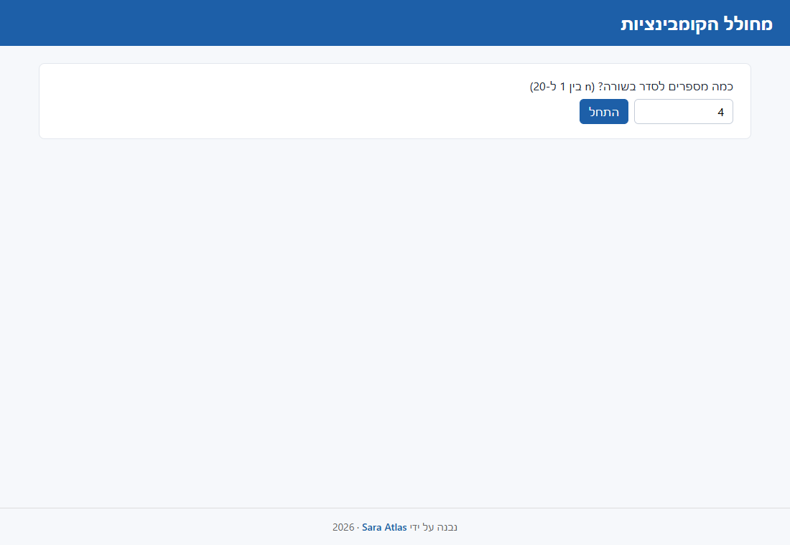
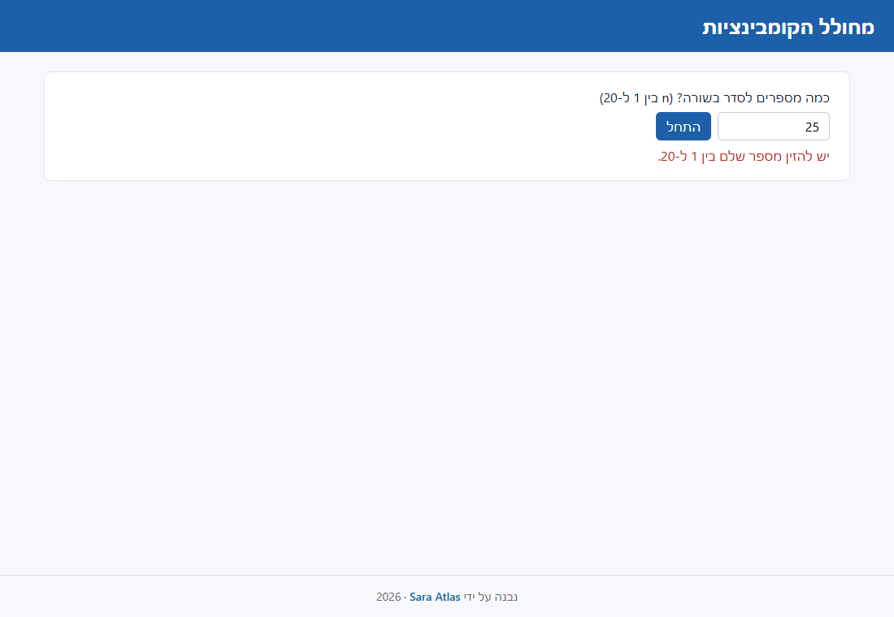
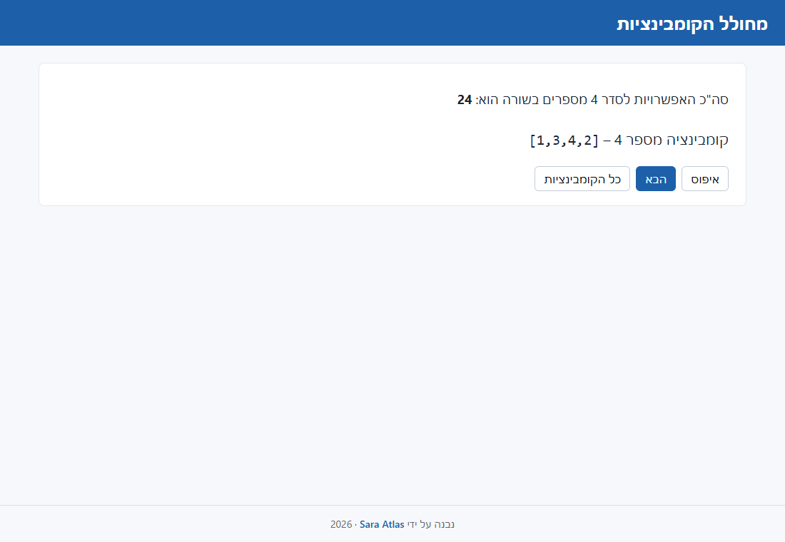
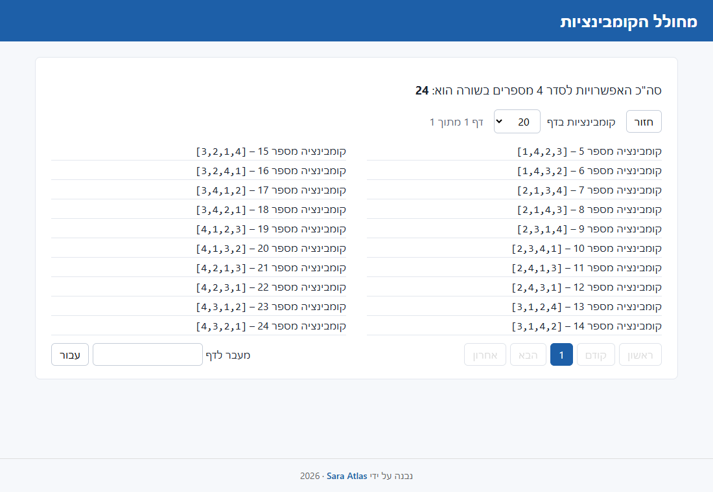
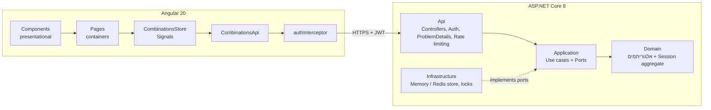

# מחולל הקומבינציות

אפליקציית Client/Server שמחוללת את כל הסידורים האפשריים (פרמוטציות) של המספרים ‎1..n‎ בשורה, עבור ‎1 ≤ n ≤ 20‎.
כל החישובים מתבצעים בצד השרת. השרת לא מחשב מראש ולא שומר אף סידור: בכל קריאה הוא מחשב רק את מה שנדרש להחזיר.

| שכבה | טכנולוגיה |
|------|-----------|
| שרת | ASP.NET Core 8 (Web API), C# 12 |
| לקוח | Angular 20 (Standalone, Signals, Zoneless, OnPush) |
| בדיקות | xUnit v3 + WebApplicationFactory (שרת), Jasmine/Karma (לקוח) |
| DevOps | Docker Compose (אופציונלי), GitHub Actions CI |

---

## איך זה עובד

**1. בוחרים n.** המשתמש מזין כמה מספרים לסדר בשורה, בין 1 ל-20.



ערך לא חוקי נחסם כבר בטופס, ובנוסף השרת מאמת אותו בעצמו.



**2. מקבלים קומבינציה אחת בכל פעם.** אחרי "התחל" מוצג מספר האפשרויות הכולל (n!). כל לחיצה על "הבא" מבקשת מהשרת את הקומבינציה הבאה בלבד, יחד עם מספרה הסידורי. "איפוס" חוזר למסך הפתיחה.



**3. צופים בכל הקומבינציות.** "כל הקומבינציות" מציג את כל הקומבינציות שאחרי הנוכחית (בצילום: 5 עד 24), בחלוקה לדפים. השרת מחשב בכל בקשה רק את הדף המבוקש, כך שגם עבור n=20 (כ-2.4 טריליון אפשרויות) אפשר לקפוץ לכל דף מיד.



---

## הרצה

**דרישות מקדימות:** ‎.NET 8 SDK‎, ‏Node.js 20.19+ / 22.

```bash
# 1. שרת  →  http://localhost:5080  (Swagger: http://localhost:5080/swagger)
cd server
dotnet run --project src/CombinationGenerator.Api

# 2. לקוח  →  http://localhost:4200
cd client
npm ci
npm start
```

הלקוח מעביר את קריאות ה-`/api` לשרת דרך ה-proxy של Angular (`proxy.conf.json`), כך שאין צורך ב-CORS בפיתוח.

**בדיקות:**

```bash
cd server && dotnet test                                     # 64 בדיקות: Domain, Application, Infrastructure, API (אינטגרציה)
cd client && npx ng test --watch=false --browsers=ChromeHeadless   # 17 בדיקות
```

7 מבדיקות השרת רצות מול **Redis אמיתי**. מקומית הן מדווחות כ-Skipped, אלא אם מגדירים `REDIS_TEST_CONNECTION=localhost:6379`. ב-CI הן רצות תמיד, מול Redis שעולה כ-service container.

בנוסף, ב-CI יש שלב `docker`. הוא בונה את שתי התמונות, מרים את כל המערכת עם `docker compose` (פעם עם אחסון בזיכרון ופעם עם Redis), ומריץ בדיקת עשן דרך nginx: טוקן ← start ← next.

**Docker (אופציונלי, לא נדרש במטלה):**

```bash
cp .env.example .env        # ולמלא GUEST_SIGNING_KEY (ההוראות בקובץ). ‏.env לא נכנס ל-git.
docker compose up --build                                 # http://localhost:8080
SESSION_STORE=Redis docker compose --profile redis up --build   # אותו דבר, עם שמירת state ב-Redis
```

---

## ארכיטקטורה



### שרת: Clean Architecture בארבעה פרויקטים

```
server/src
├── CombinationGenerator.Domain          # טהור, ללא תלויות
│   ├── Sequences/                       # ICombinatorialSequence, PermutationSequence, Factorial
│   └── Sessions/                        # GenerationSession (aggregate), SessionSnapshot
├── CombinationGenerator.Application     # Use cases + ממשקים (Ports)
│   ├── Abstractions/                    # ISessionRepository, ISessionLock, ICurrentUser
│   └── Combinations/                    # CombinationGeneratorService
├── CombinationGenerator.Infrastructure  # מימושים (Adapters)
│   └── Sessions/                        # InMemory / Redis repository (compare-and-set), StripedSessionLock
└── CombinationGenerator.Api             # HTTP: Controllers, Contracts, Security, Error handling
```

כיוון התלויות הוא תמיד פנימה: Api → Application → Domain, ו-Infrastructure מממשת את הממשקים של Application.
ה-Domain לא מכיר HTTP, DI או אחסון, ולכן נבדק כיחידה טהורה.

**נקודות הרחבה (המערכת "הולכת לגדול"):**
- **סוג רצף חדש** (צירופים k מתוך n, פרמוטציות עם חזרות וכו'): מממשים `ICombinatorialSequence` ומחזירים אותו מ-`ISequenceFactory`. ה-Session, ה-API והלקוח לא משתנים.
- **אחסון חדש** (Redis, SQL): מממשים `ISessionRepository`. כבר קיימים מימוש בזיכרון ומימוש Redis.
- **זהות:** `ICurrentUser` מנתק את שכבת ה-Application מ-HTTP ומ-JWT.
- כל ה-NuGet מנוהלים מרכזית (`Directory.Packages.props`), וה-build רץ עם `TreatWarningsAsErrors` ו-analyzers.

### לקוח: היררכיית קומפוננטות

```
client/src/app
├── core/                      # תשתית רוחבית
│   ├── auth/                  # AuthToken (sessionStorage של הטאב), authInterceptor
│   ├── storage/tab-storage.ts # שמירה ל-sessionStorage שמחזיקה רענון (כולל bigint)
│   └── http/api-error.ts      # ProblemDetails → הודעה למשתמש
├── shared/                    # רכיבים גנריים, לא תלויים בפיצ'ר
│   ├── paginator/             # Paginator + page-window (bigint, חלון דפים)
│   ├── big-number/            # BigNumberPipe → 2,432,902,008,176,640,000
│   └── alert/
└── features/combinations/     # הפיצ'ר (lazy loaded)
    ├── data/                  # CombinationsApi + models + mapping (string → bigint)
    ├── state/                 # CombinationsStore (Signals)
    ├── pages/                 # SetupPage, GeneratorPage  (containers)
    └── components/            # SizeForm, TotalSummary, StepView, AllView,
                               # CombinationList, CombinationView (presentational)
```

```
App
└── RouterOutlet
    ├── SetupPage ─────────── SizeForm, Alert
    └── GeneratorPage ─────── TotalSummary
        ├── StepView ──────── CombinationView                     (מצב "הבא")
        ├── AllView ───────── CombinationList → CombinationView,   (מצב "כל הקומבינציות")
        │                     Paginator
        └── Alert
```

רק ה-Pages מדברים עם ה-Store. כל שאר הקומפוננטות מקבלות `input()` ומחזירות `output()`, ולכן הן פשוטות לבדיקה ולשימוש חוזר.

---

## API

כל הקריאות דורשות `Authorization: Bearer <JWT>`. מספרים בני 64 ביט עוברים כמחרוזות JSON (ראו "החלטות תכנון").

| דרישה | Endpoint | גוף בקשה | תשובה |
|--------|----------|-----------|--------|
| **StartAPI** | `POST /api/combinations/start` | `{ "n": 3 }` | `201 { sessionId, n, totalCount: "6" }` |
| **GetNextAPI** | `POST /api/combinations/{sessionId}/next` | – | `200 { combination: { ordinal: "1", values: [1,2,3] }, hasMore, totalCount, message }` |
| **GetAllAPI** | `POST /api/combinations/{sessionId}/all` | `{ pageSize: 20, pageNumber: "1", anchor?: "1000" }` | `200 { items[], anchor, pageNumber, pageSize, totalPages, totalItems, totalCount, message }` |
| טוקן אורח | `POST /api/auth/guest-token` | – | `200 { accessToken, expiresAt }` |
| בריאות | `GET /health` | – | `200 Healthy` |

- כשאין יותר קומבינציות, GetNext מחזיר `200` עם `combination: null` ו-`message: "אין יותר קומבינציות"`. זה מצב עסקי תקין ולא שגיאה.
- שגיאות מוחזרות בפורמט RFC 9457 (`application/problem+json`) עם `traceId`, בלי stack trace.

---

## החלטות תכנון עיקריות

1. **סמן (cursor) אחד, אמת אחת.** ה-Session שומר את `Position`, המספר הסידורי של הקומבינציה האחרונה שהמשתמש **ראה**. גם "הבא" וגם קריאת דף מקדמים אותו. כך כל הדרישות נובעות מאינווריאנט אחד:
   - מעבר ל"כל הקומבינציות" כשמוצגת קומבינציה 1000 → דף 1 מתחיל ב-1001.
   - "חזור" → מוצגת הקומבינציה האחרונה בדף, ו"הבא" ממשיך ממנה.
2. **Anchor לדפדוף.** הקריאה הראשונה ל-GetAll לא שולחת `anchor`, והשרת משתמש במיקום הנוכחי ומחזיר אותו. הקריאות הבאות שולחות את אותו `anchor`, כך שמספור הדפים נשאר יציב גם כשהסמן זז.
3. **GetNext ו-GetAll הן `POST` ולא `GET`**, כי הן משנות state (מקדמות את הסמן). `GET` חייב להיות safe ו-idempotent.
4. **64 ביט כמחרוזת.** ‎20! = 2,432,902,008,176,640,000‎, הרבה מעבר ל-`Number.MAX_SAFE_INTEGER` (‎2⁵³−1‎). מספר JSON רגיל היה מאבד דיוק בדפדפן בלי שום שגיאה. לכן השרת כותב `long` כמחרוזת (`JsonNumberHandling`), הלקוח ממיר ל-`bigint` בשכבת ה-data, וגם ה-Paginator עובד ב-`bigint` (עבור n=20 ו-10 בדף יש כ-‎2.4·10¹⁷‎ דפים).
5. **Concurrency, בשתי שכבות:**
   - **בתוך שרת אחד:** נעילה פר-Session (lock striping, 256 סמפורים בזיכרון קבוע). שתי בקשות על אותו Session (לחיצה כפולה, שני טאבים) לא יחזירו את אותה קומבינציה פעמיים ולא ידלגו על אחת. Sessions שונים לא מחכים זה לזה.
   - **בין כמה שרתים (Redis):** ל-Session יש `Version`. השמירה היא compare-and-set: היא מצליחה רק אם הגרסה במאגר עדיין זו שנטענה. ב-Redis זה Lua script, שרץ אטומית. אם שרת אחר כתב בינתיים, הפעולה רצה שוב על ה-state העדכני (עד 10 ניסיונות עם backoff אקראי, ואחר כך `409`).
   - נבדק עם 200 קריאות מקבילות בשרת אחד, ועם 100 קריאות מקבילות דרך שני "שרתים" שחולקים מאגר.
6. **אבטחה:**
   - JWT Bearer, ו-Fallback policy שמחייבת אימות בכל endpoint.
   - **הרשאה ברמת האובייקט (BOLA):** Session שייך ל-`sub` שיצר אותו. משתמש אחר מקבל 404 גם אם ידע את ה-GUID.
   - ולידציה בשרת (‎1 ≤ n ≤ 20‎, `MaxPageSize`).
   - Rate limiting פר-משתמש.
   - MemoryCache עם תקרת Sessions ו-sliding expiration (הגנה מניצול זיכרון).
   - Security headers.
   - קונפיגורציה לא בטוחה מפילה את השרת בעלייה (fail fast).
7. **אימות במצב Demo:** אין IdP במטלה, ולכן השרת מנפיק "טוקן אורח" חתום (HS256).
   - **בפיתוח:** המפתח אקראי ונוצר בזיכרון בכל הפעלה.
   - **מחוץ לפיתוח:** חובה לספק מפתח משותף (`Auth:GuestSigningKey`) מ-secret store או ממשתנה סביבה, אחרת השרת לא עולה. כך טוקנים שורדים restart ומתקבלים בכל המופעים. אין סוד בקוד.
   - **בפרודקשן אמיתי:** מגדירים `Auth:Mode=Oidc` + `Auth:Authority` (למשל Microsoft Entra ID), והטוקן מאומת מול ה-discovery document של ה-IdP בלי שינוי קוד.
8. **שרידות לרענון דף:** הטוקן, מזהה ה-Session והקומבינציה האחרונה שהוצגה נשמרים ב-`sessionStorage` של הטאב. אחרי F5 המשתמש חוזר בדיוק לאותו מקום, ו"הבא" ממשיך. רענון במצב "כל הקומבינציות" מחזיר למצב "הבא" על הקומבינציה האחרונה בדף, בדיוק כמו "חזור". התוכן שנקרא מהאחסון עובר ולידציה, ואם הוא פגום מתעלמים ממנו.

---

## תשובות לשאלות הכלליות

### 1. מהו מודל ניהול ה-State שבחרת ולמה?

**בשרת: Server-side session state מבוסס סמן (cursor).** `StartAPI` יוצר Session עם מזהה GUID בלתי ניתן לניחוש, שקשור למשתמש (claim ‏`sub`) שיצר אותו. ה-state כולו הוא `{ n, Position, Current }`, כ-100 בתים בלי קשר ל-n: מספר הסידור האחרון שהוחזר והסידור עצמו כ-cache. **אף פעם לא נשמרת רשימת קומבינציות.**

למה דווקא כך:
- הדרישה מפורשת: ה-API צריך "לדעת" את ה-n ואת הקריאה האחרונה, וכל החישוב בשרת. לכן האמת חייבת להיות בשרת.
- ה-state זעיר ובגודל קבוע, ולכן קל להעביר אותו ל-Redis או ל-DB.
- ה-state נשמר כ-`SessionSnapshot` (record פשוט) מאחורי `ISessionRepository`. החלפת אחסון לא נוגעת בלוגיקה.

חלופות שנשקלו ונדחו:
- **Stateless** (הלקוח שולח אינדקס בכל קריאה): לא עומד בדרישה ש-GetNext ייגזר מהקריאה הקודמת, ומעביר את האמת ללקוח.
- **חישוב מראש:** אסור במפורש, ולא אפשרי (‎20!‎ סידורים).

**בלקוח: Feature store מבוסס Angular Signals.** ה-state כולו נמצא ב-signal יחיד, הקריאה ממנו נעשית דרך `computed` selectors, והשינויים רק דרך מתודות כוונה (`next`, `showAll`, `goToPage`, `back`, `reset`). זהו זרם נתונים חד-כיווני, שבו ה-Store רק משקף את מה שמוצג. Signals הם הכלי המובנה ב-Angular 20, והם עובדים נכון עם Zoneless ו-OnPush. ל-NgRx מלא אין הצדקה בגודל הזה, והמעבר ל-`@ngrx/signals` (SignalStore) פשוט אם המערכת תגדל.

### 2. מה ההבדל בין NextPermutation לחישוב Index-Based Permutation, ומתי בחרת בכל אחד?

| | **NextPermutation** (Narayana Pandita) | **Index-based / Unranking** (Lehmer code, בסיס עצרתי) |
|---|---|---|
| קלט | הסידור **הנוכחי** | **אינדקס** k בלבד |
| פעולה | הופך את הסידור לעוקב שלו, in place | מחשב ישירות את הסידור ה-k |
| סיבוכיות | O(n) במקרה הגרוע, **O(1) בממוצע**, ללא הקצאות | ‏O(n²) (עבור n=20: עד 400 פעולות) |
| גישה | סדרתית בלבד | **אקראית**, לכל מקום ברצף |
| תלות ב-state | חייב את הסידור הקודם | חייב רק מספר |

**איפה השתמשתי בכל אחד (`PermutationSequence`, `GenerationSession`):**
- **GetNext:** `NextPermutation` על הסידור השמור ב-Session. זה הצעד הזול ביותר, כי הסידור הקודם כבר בידינו. Unranking משמש רק בקריאה הראשונה, או אם הסידור השמור חסר או פגום (שחזור מ-`Position`).
- **GetAll:** **Unranking** לסידור הראשון בדף, שמאפשר קפיצה מיידית לכל דף, כולל הדף האחרון של ‎20!‎. אחר כך **NextPermutation** ל-`pageSize−1` הסידורים הבאים בדף. השילוב נותן גישה אקראית רק איפה שצריך, וצעד זול בכל השאר.

### 3. אם 3 משתמשים שונים ייכנסו בו-זמנית, איך המערכת תתנהג? למה?

כל משתמש יעבוד באופן **מבודד ומקבילי**, בלי שום השפעה על האחרים:
- **זהות נפרדת:** כל לקוח מקבל JWT עם `sub` ייחודי, ו-StartAPI יוצר לו Session משלו עם GUID משלו.
- **בידוד state:** כל Session הוא רשומה נפרדת במאגר, ואין state משותף בין משתמשים, כולל לא ב-Singleton.
- **אין גישה צולבת:** גם אם משתמש ב' ינחש או יקבל את ה-GUID של משתמש א', השרת יחזיר 404, כי בדיקת הבעלות נעשית בשכבת ה-Application.
- **מקביליות אמיתית:** ASP.NET Core מטפל בבקשות במקביל על ה-thread pool, והקוד async מקצה לקצה. הנעילה היא **פר-Session**, כך ששלושת המשתמשים לא ממתינים זה לזה. רק שתי בקשות על **אותו** Session מסודרות בתור, כדי למנוע כפילות או דילוג.
- **משאבים:** כ-100 בתים לכל Session, sliding expiration של 30 דקות, תקרת Sessions כוללת ו-rate limit פר-משתמש. משתמש אחד לא יכול להרעיב את האחרים.

- **גם אם מריצים כמה שרתים:** עם Redis, השמירה המותנית בגרסה (compare-and-set) מבטיחה ששני שרתים לא ידרסו זה את זה.

(בדיקות שמכסות את זה: `Sessions_of_different_users_are_independent`, `A_user_cannot_access_another_users_session`, `Concurrent_next_calls_on_one_session_never_return_the_same_combination_twice`, `Two_api_instances_sharing_a_store_never_return_the_same_combination_twice`.)

### 4. אם נרצה להוסיף שמירה ל-Redis, אילו 2 שינויים תעשה בצד השרת?

1. **מימוש חדש ל-`ISessionRepository` מעל Redis ורישומו ב-DI לפי קונפיגורציה.** כל Session נשמר כ-hash ‏`{ v: גרסה, d: JSON }` עם sliding TTL. הסריאליזציה של `SessionSnapshot` היא source-generated, בלי reflection. ה-connection string מגיע מהקונפיגורציה. שאר הקוד לא משתנה, וזה בדיוק מה שה-Port מאפשר.
2. **מעבר מנעילה מקומית לבקרת מקביליות מבוזרת.** עם Redis מריצים בדרך כלל כמה מופעי API, ו-`SemaphoreSlim` בתוך תהליך אחד כבר לא מגן על Session שמגיע לשני מופעים. בחרתי ב-**Optimistic concurrency:** שדה `Version` ב-snapshot, ועדכון compare-and-set אטומי ב-Lua script. אם מישהו כתב בינתיים, הפעולה רצה שוב על ה-state העדכני. החלופה היא נעילה מבוזרת (`SET key NX PX` / RedLock), אבל היא מוסיפה תלות ב-timeouts ובשחרור נעילות שנתקעו.

**שני השינויים כבר ממומשים:** `RedisSessionRepository` + `SessionStore:Provider=Redis` (ראו docker-compose). הם נבדקים באותן בדיקות חוזה (`SessionRepositoryContract`) כמו המאגר בזיכרון, מול Redis אמיתי ב-CI.

בנוסף, מפתח החתימה של הטוקנים חייב להיות משותף לכל המופעים. השרת אוכף זאת: מחוץ לפיתוח הוא לא עולה בלי `Auth:GuestSigningKey`.

### 5. מה החיסרון העיקרי של NextPermutation עבור n = 20?

**היא סדרתית בלבד.** כדי להגיע לסידור ה-k צריך לבצע k−1 צעדים מהסידור הראשון, ואין דרך "לקפוץ".
עבור n=20 יש ‎20! ≈ 2.43·10¹⁸‎ סידורים. גם בקצב אופטימי של מיליארד צעדים בשנייה, מעבר על כולם ייקח כ-**77 שנה**. לכן אי אפשר לממש עם NextPermutation בלבד "קפיצה לדף ספציפי" או "דף אחרון", וגם לא "כל הקומבינציות החל מ-X" כש-X גדול.
חיסרון משני: היא תלויה בסידור הקודם כ-state. אם הוא אבד, אי אפשר להמשיך בלי לחשב אותו מחדש.
לכן הפתרון משלב Unranking לגישה אקראית (O(n²) לכל k) ו-NextPermutation לצעדים העוקבים.

---

## מעבר ל-.NET 10

הפרויקט עומד בדרישת המטלה (‎.NET 8‎). השדרוג ל-‎.NET 10‎ (LTS) הוא שינוי של `TargetFramework` ב-`Directory.Build.props`, גרסאות החבילות ב-`Directory.Packages.props` ו-`global.json`.
